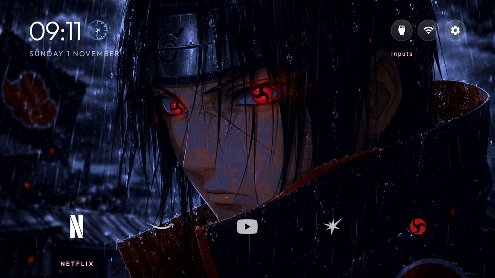
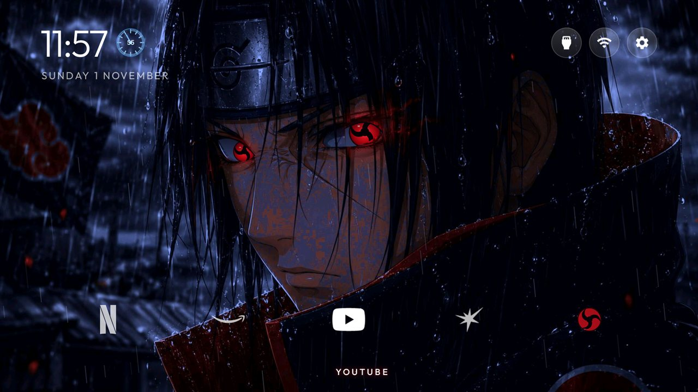
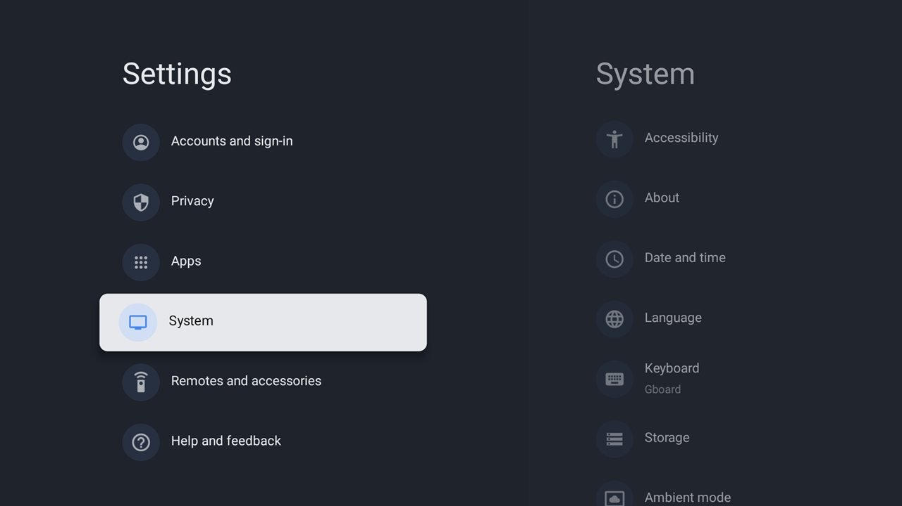

# Itachi TV 🍥

A custom **Android TV home screen** with living Mangekyō Sharingan eyes, rain, crows and a clean logo dock,
plus **Itachi Voice**: a voice assistant you talk to in **Tamil or English**, answered out loud by Claude.

Built for a Xiaomi MiTV (Android TV 11) on top of the open-source
[CleanYourTV](https://github.com/Gathin23/cleanyourtv) launcher (MIT).



## Features

### Itachi launcher
| | |
|---|---|
| 👁️ **Living eyes** | Itachi's eyes are redrawn as a Mangekyō Sharingan that looks toward the app you select, glances around, blinks, and spins when you come back Home. |
| 🌧️ **Rain** | Light rain falls over the scene and leans toward the selected app. |
| 🐦 **Crows** | Opening an app makes the eyes flare and a flock of crows scatter from its logo. |
| 🌌 **Depth** | The wallpaper drifts gently as you move between apps. |
| 🎯 **Clean dock** | Five evenly spaced white logos. The selected one grows, brightens and shows its name. |
| 🧩 **All apps** | An All apps mark at the end of the dock opens every installed app. |
| 🎨 **Original glyphs** | Apps without a logo get matching icons (store, games, music, live TV, settings, files, web) or their initial. |
| 📺 **Top bar** | Inputs (HDMI / AV / TV), Wi-Fi and Settings as round buttons; the name appears under the selected one. |



### Itachi Voice
| | |
|---|---|
| 🎙️ **Talk** | Open it and speak. Press **OK** to talk again. |
| 🧠 **Claude answers** | Short, spoken answers from Claude Haiku 5.5. It remembers the last few questions. |
| 🗣️ **Tamil + English** | Speak either, or mix them. Tamil answers are read with the Tamil voice. **◀ ▶** switches which language it listens for first. |
| ⚡ **Instant commands** | "open Netflix", "volume up", "mute" work offline. Claude can open apps too: "Netflix open pannu". |
| 🔴 **Reactive Sharingan** | Pulses with your voice, spins while thinking, glows while speaking. |



---

## What you need

- An **Android TV** or Google TV, Android 8 or newer (tested: Xiaomi MiTV MOOR2, Android TV 11).
- A **Windows PC** on the same Wi-Fi as the TV.
- **Python 3**, and **JDK 17 + Android SDK (platform 34)**. Installing [Android Studio](https://developer.android.com/studio) gives you both.
- A **Claude API key** from [console.anthropic.com](https://console.anthropic.com) with a little credit (a question costs a fraction of a cent), for Itachi Voice.

## Setup, step by step

### 1. Turn on debugging on the TV
1. **Settings → Device Preferences → About** → press OK on **Build** 7 times ("You are now a developer").
2. **Settings → Device Preferences → Developer options** → turn on **USB debugging** (and **Network debugging** if your TV has it).
3. Note the TV's IP address: **Settings → Network & Internet →** your Wi-Fi network.

### 2. Get CleanYourTV and this project
```powershell
git clone https://github.com/Gathin23/cleanyourtv.git
cd cleanyourtv
python -m venv tools\venv
tools\venv\Scripts\pip install -r tools\requirements.txt
```
Copy the three folders from this `itachi-tv` folder (`itachi-launcher`, `itachi-voice`, `itachi-inspired`) into
`cleanyourtv\work\` (create `work` if it is missing). The scripts reach the TV through `cleanyourtv\tools`.

### 3. Tell the scripts your TV's address
Create `cleanyourtv\work\tv-ip.txt` containing just the IP, for example `192.168.1.50`.
(If the file is missing, each script asks for it.)

### 4. Add wallpapers
The artwork is not included: it belongs to its artist. Put your own **1920 × 1080** pictures in
`itachi-inspired\wallpapers\` (and one as `itachi-inspired\wallpaper.jpg`).
The eye positions in `ItachiArtView.java` match the Itachi picture the theme was made for; with a different
picture, adjust the eye coordinates at the top of that file.

### 5. Install the launcher
Double-click **`itachi-launcher\build-install.bat`**. It builds the launcher, installs it, pushes the theme
and restarts Home. Accept **"Allow debugging?"** on the TV the first time (tick *Always allow*).
The log is saved to `itachi-launcher\build.log`.

### 6. Install Itachi Voice
Double-click **`itachi-voice\build-install.bat`**, then **`itachi-voice\set-claude-key.bat`** and paste your
Claude API key (right-click pastes). It should print `saved: key`. The key goes straight to the TV and is never
written to a file.

### 7. Finish
Turn **USB / Network debugging off** on the TV when you're done: while it is on, anyone on your network can control the TV.

---

## Using it

| Remote | Home screen | Itachi Voice |
|---|---|---|
| ◀ ▶ | Move between apps | Tamil first / English first |
| ▲ | Top bar (Inputs, Wi-Fi, Settings) | Scroll a long answer |
| OK | Open the app (eyes flare, crows fly) | Speak / speak again |
| Menu | — | New conversation |
| Back | — | Stop / close |

If a Tamil answer shows on screen but isn't spoken, install the Tamil voice:
**Settings → Device Preferences → Text-to-speech → Install voice data → Tamil (India)**.

## Customise

Edit `itachi-inspired\config.json`, then run `itachi-launcher\build-install.bat` again (or push only the theme with
`tools\theme.ps1 -TvHost <tv ip> work\itachi-inspired`). Useful keys:

| Key | What it does |
|---|---|
| `dock_apps` | The apps in the dock, in order (package names) |
| `columns` | Logos per row (5) |
| `wallpaper_rotation_minutes` | Change the wallpaper every N minutes |
| `wallpaper_order` | `shuffle` or `sequential` |
| `hidden_apps` | Packages never shown |
| `show_inputs_pill`, `icon_only_inputs` | The Inputs button |

Every key is listed in CleanYourTV's `themes/README.md`.

## Troubleshooting

| Problem | Fix |
|---|---|
| "No JDK 17+ found" | Install Android Studio, or set `JAVA_HOME` to a JDK 17 folder. |
| "Copying the APK to the TV failed" | Check `tv-ip.txt`, that the TV is on, and accept "Allow debugging?" on the TV. |
| `pm install failed` / `UPDATE_INCOMPATIBLE` | The launcher on the TV was signed on another PC. Build on the PC that installed it first. |
| Voice: "Setup needed" | Run `set-claude-key.bat`. |
| Voice: "API key was refused" / "no credit" | Check the key and the credit at console.anthropic.com. |
| Voice doesn't hear you | The remote's mic button belongs to Google Assistant; open Itachi Voice and press OK instead. |

## Project layout

```
itachi-tv/
├── itachi-launcher/   Android launcher (Java, fork of CleanYourTV's launcher)
│   └── app/src/main/java/com/gathin/tvhome/
│       ├── ItachiArtView.java   living Mangekyō eyes
│       ├── ItachiFxView.java    rain and crows
│       ├── ItachiHaloView.java  focus ring (off by default)
│       └── MonogramDrawable.java  initials for apps without a logo
├── itachi-voice/      Itachi Voice app (Java): speech → Claude → speech
├── itachi-inspired/   theme config.json and notes
└── screenshots/
```

## Credits and licence

- Launcher: a fork of [CleanYourTV](https://github.com/Gathin23/cleanyourtv) by its contributors, MIT licence. Font and
  icon licences are in `itachi-launcher/`.
- Itachi Voice uses the [Claude API](https://docs.claude.com).
- Itachi and Naruto belong to Masashi Kishimoto / Shueisha. This is a personal fan project, not affiliated with or
  endorsed by them. The screenshots show the fan wallpaper used on my own TV; it is not distributed here.
